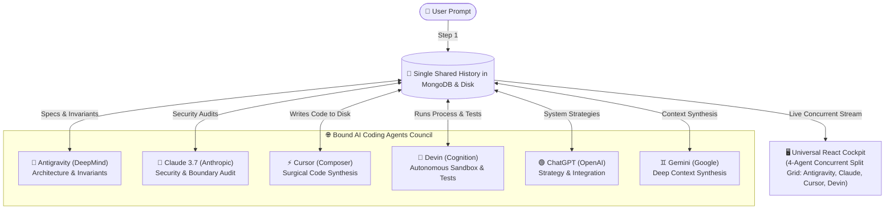

# 🌐 Universal AI Coding Agents Studio (MERN Stack)
### *Uniting Antigravity, Claude, Cursor, Devin, ChatGPT & Gemini over a Single Shared History*

A production-ready **MERN (MongoDB, Express, React, Node.js)** application combining the world's most powerful AI coding agents:
- 🚀 **Antigravity** (Google DeepMind) — High-order architectural reasoning, system artifacts, and modular invariant specification.
- 🧠 **Claude** (Anthropic Claude 3.7 / 3.5 Sonnet) — Nuanced logic, rigorous security audits, and zero-waste refactors.
- ⚡ **Cursor** (Anysphere Composer) — Multi-file surgical diff authoring and rapid code synthesis.
- 🤖 **Devin** (Cognition AI) — Autonomous environment QA, test authoring, and sandbox test execution.
- 🟢 **ChatGPT** (OpenAI GPT-4o) — Broad ecosystem strategies, performance trade-offs, and microservice topology.
- ♊ **Gemini** (Google Gemini 2.0 Flash) — Deep contextual synthesis and full-repo understanding.
- 🛠️ **Aider** (Paul Gauthier) — Git-centric pair programming and conventional documentation.

All bound to a **Single Canonical History** in MongoDB & Local Disk!

---

## 💡 The Core Breakthrough: Single Shared History

Instead of juggling separate tools where each assistant starts from zero context:
1. **One Unified Event Stream**: Every prompt, agent deliberation (`<thought>`), multi-file code generation, security audit, test execution, and user feedback is committed to a single chronological timeline.
2. **True Inter-Agent Awareness**: 
   - **Antigravity** defines architectural invariants and file topology.
   - **Claude** reviews Antigravity's thoughts and performs a security/boundary audit.
   - **Cursor** synthesizes the production code into workspace files.
   - **Devin** runs automated sandbox tests and verifies execution.
   - **ChatGPT** & **Gemini** synthesize cross-system integration and documentation.
3. **On-Demand Summoning or Full Roundtable Council**:
   - Summon any specific agent with a single click on their roster badge.
   - Or click **⚡ Roundtable (All Real Agents)** to run the full collaborative pipeline sequentially!



---

## 🛠️ The MERN Architecture

| Component | Role in the System |
| :--- | :--- |
| **MongoDB (M)** | Stores the immutable chronological event stream (`HistoryEntry`), sessions (`Session`), and workspace codebase files (`WorkspaceFile`). Includes automatic **Resilient In-Memory fallback** if MongoDB is offline. |
| **Express.js (E)** | REST API on port `5000` providing endpoints for session lifecycle, agent summoning (`/api/sessions/:id/summon-agent`), settings management (`/api/settings`), and physical disk file I/O. |
| **React (R)** | Modern interactive studio UI featuring live agent cards, the single shared history stream with expandable thoughts, tool execution logs, and an integrated code editor with file tabs and disk sync. |
| **Node.js (N)** | Runtime orchestrating turn-taking, executing real tools (`child_process.exec` & `fs`), dispatching live HTTPS calls to Anthropic/OpenAI/Gemini/Ollama, or graceful deterministic fallbacks. |

---

## 🚀 Quickstart Guide

### Method 1: Desktop Shortcut (Zero-Install Windows)
Double-click the desktop shortcut:
```bat
Run_Multi_Agents.bat
```
This automatically verifies dependencies, starts the Express server on port `5000`, and opens `http://localhost:5000` in your default browser.

---

### Method 2: Manual Start
In the root directory (`multi_coding_agents`):
```bash
# 1. Install dependencies
npm install

# 2. Start server
npm run server
```
*Open `http://localhost:5000` in your browser.*

---

## ⚙️ Real API Keys & Live Models Setup

The application features a built-in **⚙️ Real API Keys & Models** modal in the top navigation bar:
1. Click **⚙️ API Keys & Live Models** in the top-right header.
2. Enter your real API keys:
   - **Anthropic API Key**: `sk-ant-api03-...` (Powers 🧠 Claude 3.7 / 3.5 Sonnet)
   - **OpenAI API Key**: `sk-...` (Powers 🟢 ChatGPT, ⚡ Cursor, 🤖 Devin)
   - **Google Gemini API Key**: `AIzaSy...` (Powers 🚀 Antigravity & ♊ Gemini 2.0)
   - **Ollama / Local URL**: `http://localhost:11434/v1` (Powers free offline local models)
3. Click **💾 Save & Activate Real Agents**.
4. Keys are automatically saved to your `.env` file and live badges indicate which models are active!

> **Offline Preview**: If you haven't entered API keys yet, the application gracefully operates using a built-in high-fidelity emulation engine, ensuring complete usability and testing without cost or internet connection.

---

## 💻 Physical Workspace & Tool Execution

Files generated by agents or edited by the user are mirrored directly to physical disk:
```
server/workspace/<sessionId>/
├── coreService.js       # Synthesized by Cursor / User
└── testSuite.js         # Automated test suite run by Devin
```
- **Real Disk Writes**: Agent `write_file` calls write UTF-8 files to the physical filesystem.
- **Real Terminal Execution**: Devin and testing tools execute real Node/Python processes in the workspace directory via `child_process.exec`.
- **Editor Sync**: Hit `Ctrl+S` in the code editor to save changes directly to disk and database.

---

## 📂 Project Structure

```
multi_coding_agents/
├── server/                       # Node.js + Express Backend
│   ├── config/
│   │   ├── db.js                 # MongoDB connection & in-memory fallback
│   │   └── agentsCatalog.js      # Metadata for Antigravity, Claude, Cursor, Devin, etc.
│   ├── models/                   # Mongoose Data Schemas
│   │   ├── HistoryEntry.js       # Core Single Shared History collection
│   │   ├── Session.js            # Coding task sessions
│   │   └── WorkspaceFile.js      # Files generated by agents
│   ├── agents/                   # Multi-Agent Engine
│   │   ├── SingleSharedHistory.js# Unified history manager & prompt projector
│   │   ├── UniversalOrchestrator.js# Multi-agent router & roundtable coordinator
│   │   └── Orchestrator.js       # Pipeline runner
│   ├── services/
│   │   ├── realLLMProvider.js    # Live HTTPS clients for Anthropic, OpenAI, Gemini, Ollama
│   │   ├── realToolRunner.js     # Real disk file I/O & child process execution
│   │   ├── settingsManager.js    # Dynamic API key management & .env persistence
│   │   ├── dbService.js          # Dual MongoDB/Memory abstraction layer
│   │   └── llmService.js         # Unified LLM dispatcher with fallback
│   ├── routes/
│   │   └── api.js                # REST API endpoints (/api/settings, /api/sessions, etc.)
│   ├── public/
│   │   └── index.html            # Standalone zero-install React Web Studio
│   └── server.js                 # Express entrypoint (Port 5000)
│
├── client/                       # Vite React Frontend
│   ├── src/
│   │   ├── App.jsx               # Studio UI with agent roster, history, and settings
│   │   ├── components/
│   │   │   └── CodeEditor.jsx    # Code editor with line numbers, tabs & review tools
│   │   ├── index.css             # Developer dark-mode styling
│   │   └── main.jsx              # React DOM mounting
│   └── dist/
│       └── index.html            # Pre-bundled client assets
│
├── .env                          # Configuration (port, database, API keys)
├── run.bat                       # Project launch script
└── README.md                     # Documentation
```
